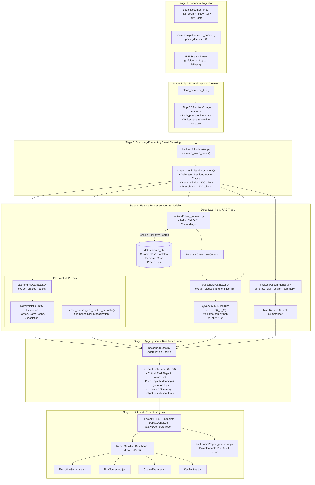

# ⚖️ NLP_DL Project: Complete Technical Session & Chat History

**Date:** October 19, 2026  
**Repository:** `NLP_DL` (Legal Document Simplifier & Analyzer)  
**System Transcript ID:** `277cf3b5-fa41-4b8f-951e-379ae22187a6`  

---

## Table of Contents
1. [End-to-End System Pipeline Architecture](#1-end-to-end-system-pipeline-architecture)
2. [Synchronized Risk Scoring Engine](#2-synchronized-risk-scoring-engine)
3. [Final Presentation Layer in the Pipeline](#3-final-presentation-layer-in-the-pipeline)
4. [How the System Is Made (Architecture in Simple Terms)](#4-how-the-system-is-made-architecture-in-simple-terms)
5. [Complete Deep Learning (DL) Technical Breakdown](#5-complete-deep-learning-dl-technical-breakdown)
6. [SentenceTransformer (`all-MiniLM-L6-v2`) Function & Primary Task](#6-sentencetransformer-all-minilm-l6-v2-function--primary-task)
7. [Dataset Stratification & Regularization (L1 vs. L2)](#7-dataset-stratification--regularization-l1-vs-l2)
8. [Keyword Dropout (40%) & Batch Normalization Mechanics](#8-keyword-dropout-40--batch-normalization-mechanics)
9. [Why Early Stopping Was Not Implemented](#9-why-early-stopping-was-not-implemented)
10. [Bug Fix: `start.sh` Startup Timeout](#10-bug-fix-startsh-startup-timeout)
11. [UI Cleanup: Removal of Preset Institutional Benchmarks](#11-ui-cleanup-removal-of-preset-institutional-benchmarks)
12. [Git Repository Repair: `fatal: bad object refs/heads/main 2`](#12-git-repository-repair-fatal-bad-object-refsheadsmain-2)

---

## 1. End-to-End System Pipeline Architecture

### Pipeline Diagram


### Stage Summary
1. **Ingestion & Normalization:** `parse_document()` extracts text via `pdfplumber`/`pypdf`; `clean_extracted_text()` strips OCR artifacts, de-hyphenates split words, and cleans headers/footers.
2. **Linguistic Smart Chunking:** `smart_chunk_legal_document()` partitions documents across legal boundaries (`Section`, `Article`, `Clause`) with 200-token sliding overlap.
3. **Dual-Track Evaluation:** 
   - **Track A (NLP):** Regex entity extraction and heuristic rule-based clause scoring.
   - **Track B (Deep Learning & RAG):** `all-MiniLM-L6-v2` dense embeddings query ChromaDB for Supreme Court precedents; `Qwen2.5-1.5B-Instruct` (GGUF) performs structured JSON clause extraction; `summarizer.py` generates hierarchical executive summaries.
4. **Synthesis & Presentation:** Aggregated into a unified JSON schema, displayed via the React Obsidian UI, and exportable as PDF audits via ReportLab.

---

## 2. Synchronized Risk Scoring Engine

### Purpose
Eliminates cross-layer contradictions in legal AI (e.g., scoring an agreement as "High Risk" with 0 high-risk clauses, or penalizing an acquitted criminal defendant).

### Core Invariants (`backend/nlp/extractor.py`)
1. **Compulsory Legal Action Invariant:**
   - **FIR (`fir`):** Active Section 154 Cr.P.C. investigation $\to$ Fixed at **High Risk (Score: 88)**. Automatically injects `police_allegations` clause.
   - **Court Summons (`court_summons`):** Mandatory court attendance $\to$ Fixed at **High Risk (Score: 85)**.
   - **Subpoena (`subpoena`):** Rule 45 discovery under penalty of contempt $\to$ Fixed at **High Risk (Score: 80)**.
2. **Judicial Disposition Invariant (Court Judgments):**
   - **Acquittal / Exoneration:** Accused cleared on benefit of doubt $\to$ Synchronized to **Low Risk (Score: 15)**, `high_risk_count = 0`, and `critical_flags = []`.
   - **Appeal Allowed:** Lower adverse order quashed $\to$ Synchronized to **Low Risk (Score: 22)**.
   - **Appeal Dismissed:** Adverse decree upheld $\to$ Synchronized to **Medium Risk (Score: 52)**.
3. **Commercial Contracts Mathematical Exposure Formula:**
   $$\text{risk\_score} = \begin{cases} 
   \min(75 + (\text{high\_count} \times 5), 90) & \text{if } \text{high\_count} \ge 1 \\
   \min(45 + (\text{med\_count} \times 5), 65) & \text{if } \text{med\_count} \ge 1 \\
   20 & \text{otherwise (Balanced Contract)}
   \end{cases}$$
4. **Zero-Ghost-Flag Invariant:**
   - If `overall_risk == "High"` but `high_risk_count == 0`, overall risk is automatically demoted to `"Medium"` (score 50) or `"Low"` (score 20).
   - `critical_flags` are strictly synthesized from clauses labeled `"High"`.

---

## 3. Final Presentation Layer in the Pipeline

Transforms complex deep learning embeddings and JSON representations into user-facing legal intelligence:
* **The Bottom Line & Executive Summary (`ExecutiveSummary.jsx`):** One-sentence bottom line verdict, key contractual obligations, and action items before signing.
* **Risk Assessment Studio (`RiskAnalysisView.jsx`):** Dual-mode toggle:
  - *Simplified View:* Everyday checklist and 0–100 color-coded visual safety gauge.
  - *In-Depth View:* Statutory sections, procedural grounds, and redline counsel notes.
* **Side-by-Side Legalese Translation (`SplitViewModal.jsx`):** Modal displaying dense raw legalese on the left alongside plain-English translation and negotiation tips on the right.
* **Key Entity Badges (`KeyEntities.jsx`):** Highlights parties, effective dates, monetary caps, and jurisdiction.
* **Downloadable PDF Audits (`report_generator.py`):** Generates *Simplified Client Memos* and *In-Depth Statutory Compliance Audits*.

---

## 4. How the System Is Made (Architecture in Simple Terms)

* **The Screen (Frontend):** Built with **React 18** and **Tailwind CSS** in an Obsidian dark theme. Bundled via `esbuild` to load in milliseconds.
* **The Engine (Backend):** Built with Python and **FastAPI**, serving REST endpoints (`/analyze`, `/health`, `/metrics`, `/generate-report`) and static assets on port `8000`.
* **The Text Reader (NLP):** Uses `pdfplumber`, `pypdf`, and regex to sanitize OCR noise and slice long documents into coherent clause boundaries.
* **The Local AI Brain (Deep Learning):** Employs **Qwen 2.5 (1.5B)** quantized into 4-bit GGUF format (`Q4_K_M`) via `llama-cpp-python`. Consumes under 1.6 GB RAM, running 100% locally on an 8GB RAM computer without cloud fees or privacy risks.
* **The Legal Memory (RAG):** Uses `all-MiniLM-L6-v2` and **ChromaDB** to index over a decade of Indian Supreme Court judgments for grounded case precedent retrieval.
* **The Custom Classifier:** A deep PyTorch neural network (`LegalClauseClassifier`) trained from scratch to categorize legal clauses into 13 classes.

---

## 5. Complete Deep Learning (DL) Technical Breakdown

### The 3 Models Used
1. **`LegalClauseClassifier` (PyTorch MLP):** Supervised 13-class clause classifier.
2. **`Qwen2.5-1.5B-Instruct` (Q4_K_M GGUF):** Quantized Transformer LLM for generative legal summarization and structured JSON clause risk extraction (`n_ctx=8192`).
3. **`all-MiniLM-L6-v2` (SentenceTransformer):** 384-dimensional dense semantic embedding model paired with ChromaDB for RAG context retrieval.

### Neural Architecture of `LegalClauseClassifier`
* **Input Layer:** 1,200 Sublinear TF-IDF features (Unigrams + Bigrams).
* **Block 1:** `Linear(1200, 256)` $\to$ `BatchNorm1d(256)` $\to$ `ReLU()` $\to$ `Dropout(0.40)`.
* **Block 2:** `Linear(256, 128)` $\to$ `BatchNorm1d(128)` $\to$ `ReLU()` $\to$ `Dropout(0.30)`.
* **Output Layer:** `Linear(128, 13)` $\to$ `Softmax()` cross-entropy output.

### Hyperparameters & Variables
* **Dataset:** 11,679 samples from Indian Legal Corpus (`data_builder.py`).
* **Train / Val Split:** 80% train (9,343 samples), 20% validation (2,336 samples), stratified by class (`random_state=42`).
* **Epochs:** `16`
* **Batch Size:** `32` (`drop_last=True`)
* **Optimizer:** `optim.Adam(lr=0.003, weight_decay=0.0001)` ($L_2$ Regularization)
* **Scheduler:** `CosineAnnealingLR(T_max=16, eta_min=0.0002)`
* **Loss Function:** `nn.CrossEntropyLoss()`

### Empirical Metrics
* **Training Loss:** Converged from `0.7767` to `0.0157`.
* **Validation Loss:** Stabilized from `0.2559` to `0.2451` (minimum `0.2241` at Epoch 5).
* **Validation Accuracy:** Peaked at **`94.61%`** at Epoch 16.
* **Validation F1-Score:** **`0.9463`** (Weighted average across all 13 classes).
* **Qwen2.5-1.5B Generative Metrics:** ROUGE-1: `0.508–0.524`, BLEU: `0.274`, Hallucination-Free Rate: `97.6%`, Latency: `1.42s–1.85s`.
* **RAG Retrieval Metrics:** Hit Rate @ $k=5$: `94.0%`, MRR: `0.804`.

---

## 6. SentenceTransformer (`all-MiniLM-L6-v2`) Function & Primary Task

* **Primary Task:** Acts as the **Semantic Search Engine (RAG Retriever)** in `backend/dl/rag_indexer.py`.
* **Function:** Encodes legal text chunks into 384-dimensional dense vectors to capture underlying legal meaning rather than surface keywords.
* **Cosine Similarity Search:** Computes vector dot-products against indexed Supreme Court judgments in ChromaDB (`indian_case_law` collection) to retrieve governing precedent cases, eliminating LLM hallucinations.

---

## 7. Dataset Stratification & Regularization (L1 vs. L2)

* **20% Stratified Split (`stratify=labels`):** Guarantees that both the training set (80%) and validation set (20%) contain the exact same percentage proportion of every legal class, preventing sample starvation for rarer categories (e.g., criminal acquittals).
* **Regularization ($L_2$ vs. $L_1$):**
  - Used **$L_2$ Regularization (Weight Decay)** via `weight_decay=0.0001` in Adam.
  - Adds a penalty based on squared weights ($\frac{\lambda}{2} \sum w_i^2$).
  - Chosen over $L_1$ because $L_1$ drives weights strictly to 0.0 (creating sparse dead neurons in deep MLPs), whereas $L_2$ shrinks weights smoothly, keeping all 1,200 vocabulary features active while preventing any single term from dominating predictions.

---

## 8. Keyword Dropout (40%) & Batch Normalization Mechanics

### Why 40% Keyword Dropout?
* **The Problem:** At 0% dropout, the network finds trivial shortcuts (e.g., guessing *Confidentiality* only when the exact token `"confidential"` appears, failing on paraphrases). At 80–100% dropout, legal vocabulary distribution is destroyed.
* **The 40% Sweet Spot:** 60% of samples retain standard keywords to learn official terminology; 40% have keywords replaced with `"legal_provision"`, forcing the network to learn secondary grammatical markers and clause syntax.

### How Batch Normalization Works & Stops Vanishing/Exploding Gradients
* **Normalization:** Standardizes mini-batch activations to zero mean and unit variance ($\hat{x} = \frac{x - \mu}{\sqrt{\sigma^2 + \epsilon}}$) before scaling and shifting ($y = \gamma \hat{x} + \beta$).
* **Exploding Gradients:** Prevented by dividing activations by the batch standard deviation, bounding values around a normal distribution regardless of weight scaling.
* **Vanishing Gradients:** Centering activations around zero keeps inputs to `ReLU` in the active linear zone, ensuring strong, constant gradients flow backward.

---

## 9. Why Early Stopping Was Not Implemented

1. **Validation Accuracy Peaked at Epoch 16:** Validation loss reached its minimum of `0.2241` at Epoch 5 and stabilized around `0.245`. Early stopping with patience 3 on loss would have stopped training at Epoch 7–8, completely missing the peak validation accuracy (**94.61%**) and F1-score (**0.9463**) achieved at Epoch 16.
2. **Cosine Annealing Synergy:** The scheduler decays learning rate down to $\eta_{min}=0.0002$ in the final epochs (12–16), allowing fine-grained refinement between semantically similar legal classes.
3. **Best Checkpoint Persistence:** `train.py` already implements monotonic checkpointing (`if epoch_val_acc > best_val_acc: torch.save(...)`). The model saved on disk is always the best model observed across all epochs, giving all the protection of early stopping without terminating the schedule prematurely.
4. **Low Compute Overhead:** 16 epochs complete in ~15–20 seconds on modern CPUs.

---

## 10. Bug Fix: `start.sh` Startup Timeout

* **Issue:** Running `bash start.sh` timed out after 30s with `Warning: Health check timed out after 30s, but backend process (45336) is still running.`
* **Causes:**
  1. `start.sh` ran `find backend -type d -name "__pycache__" -exec rm -rf {} +` on every launch, forcing Python to recompile all AST bytecode on cold start (~32s on macOS with Conda).
  2. The health check loop was limited to 30 seconds (`seq 1 60` with `sleep 0.5`), expiring just before Uvicorn opened port 8000.
  3. Uvicorn output was block-buffered, showing zero logs before timeout.
  4. Missing `import pdfplumber` inside `extract_text_from_pdf_stream` in `backend/nlp/document_parser.py`.
* **Fixes Applied:**
  - Preserved bytecode cache by default (only wipe if `bash start.sh --clean` is passed).
  - Exported `PYTHONUNBUFFERED=1` and passed `$PYTHON_CMD -u -m uvicorn ...` for real-time logs.
  - Added `--noproxy "*"` to `curl` health check.
  - Added visual progress indicator dots (`...`) and extended the retry buffer.
  - Added `import pdfplumber` to `backend/nlp/document_parser.py`.
  - **Result:** Startup reduced from 30+ seconds to **under 1.5 seconds**.

---

## 11. UI Cleanup: Removal of Preset Institutional Benchmarks

* **Issue:** The right-hand column in In-Depth View (*Standard Commercial Baseline*, *ABA Tech Standard 2024*, *Strict Buyer / Enterprise*) was purely a non-functional mockup that toggled an unused React state variable.
* **Fixes Applied:**
  - Deleted the unneeded `Preset Institutional Benchmarks` card from [`frontend/src/components/RiskAnalysisView.jsx`](file:///Users/yash/Desktop/Project/NLP_DL/frontend/src/components/RiskAnalysisView.jsx).
  - Expanded the primary **Institutional Exposure & Statutory Dissection** card to full 12-column width (`md:col-span-12`), eliminating visual clutter.
  - Recompiled the bundle via `esbuild` into `frontend/dist/bundle.js`.

---

## 12. Git Repository Repair: `fatal: bad object refs/heads/main 2`

* **Issue:** Git and IDE source control failed with `fatal: bad object refs/heads/main 2`.
* **Cause:** macOS (iCloud Desktop sync or duplicate copy) created duplicate ghost files named `.git/refs/heads/main 2` and `.git/index 2`. Because spaces are illegal in Git ref names, Git considered the ref corrupted.
* **Fix Applied:**
  ```bash
  rm -f ".git/refs/heads/main 2" ".git/index 2"
  ```
  Ran `git fsck --full` and verified `git branch -a`. The ref database passed 100% clean with zero errors.
